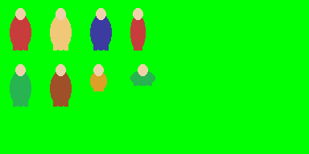

# SpriteSlicer CLI 🎮✂️

<p align="center">
  
</p>

<p align="center">
  <b>High-Performance Sprite Sheet Slicer, Chroma-Key Background Remover & AI Upscaler</b><br/>
  <i>Created with ❤️ by <b><a href="https://github.com/NyxaCode">NyxaCode</a></b></i>
</p>

<p align="center">
  <a href="https://github.com/NyxaCode/SpriteSlicer-CLI/blob/main/LICENSE"></a>
  
  
  
  <a href="https://github.com/NyxaCode"></a>
</p>

---

> 💡 **100% FREE TO USE**: SpriteSlicer CLI adalah software gratis dan open-source (FOSS) di bawah lisensi MIT. Bebas digunakan tanpa biaya untuk kebutuhan pribadi, game indie, maupun proyek komersial studio game Anda.

---

## ✨ Features

- ✂️ **Smart Auto-Detect & Grid Slicing**: Memotong sprite sheet secara otomatis berdasarkan kontur atau sistem kisi (*uniform grid*).
- 🟢 **Intelligent Chroma-Keying**: Menghilangkan background warna (hijau, putih, hitam) tanpa merusak warna objek di dalam sprite yang mirip background (border flood-fill + despill).
- 🚀 **Built-in Real-ESRGAN AI Upscaling**: Upscale sprite 2x, 3x, hingga 4x menggunakan akselerasi GPU Vulkan offline (tanpa kuota cloud / API key).
- 🗂️ **Game Engine Ready**: Menghasilkan file PNG transparan individual, katalog preview kontak, serta `manifest.json` koordinat bounding box yang siap diimpor ke Unity, Godot, Unreal, atau Pygame.
- 🖱️ **Zero Coding Needed**: Dilengkapi script `.bat` praktis untuk menu interaktif dan drag-and-drop.

```
sheet.png  ──▶  [ Upscale 2x/4x ]  ──▶  [ Chroma Key + Slice ]  ──▶  sprites/row_01/sprite_r01_c01.png
                                                                       sprites/row_02/…
                                                                       manifest.json
                                                                       catalog_preview.png
```

---

## ⚡ Quick Start (Windows)

Tidak perlu setup Python global atau manual pip rumit:

```cmd
# 1. Setup satu kali (membuat lingkungan virtual .venv lokal)
install.bat

# 2. Jalankan!
start.bat
```

> **Tip:** Jika Anda langsung menjalankan `start.bat`, script akan otomatis mendeteksi apakah instalasi pertama kali diperlukan dan menawarkan instalasi mandiri.

---

## 🚀 3 Cara Penggunaan

### 1. Menu Interaktif (Paling Mudah)
Cukup dobel-klik **`start.bat`** di File Explorer:
```cmd
start.bat
```
Terminal akan memandu langkah demi langkah:
- Input path gambar / folder
- Pilihan chroma-key background
- Mode potong (Auto-detect atau Grid)
- Pilihan AI Upscale (1x / 2x / 3x / 4x)
- Folder tujuan

---

### 2. Drag and Drop Langsung
Tarik (drag) file sprite sheet Anda dari File Explorer dan lepaskan (drop) tepat di atas file **`slice.bat`**. Selesai!

---

### 3. Perintah Baris CLI (PowerShell / Command Prompt)

**Proses satu file:**
```cmd
start.bat -i sheet.png
start.bat -i sheet.png -o folder_output -k green
start.bat -i icon_sheet.png -k white -o icons_out
```

**Proses Batch (Semua gambar di dalam folder):**
```cmd
start.bat -d .\sheets -o .\batch_out
start.bat -d .\sheets -o .\batch_out --recursive
```
*Setiap gambar otomatis diproses ke sub-folder masing-masing.*

**Dengan AI Upscaling GPU:**
```cmd
start.bat -i sheet.png -s 2 -m realesrgan-x4plus-anime
start.bat -i sheet.png -s 4 -m realesrgan-x4plus
```

**Mode Uniform Grid (misal 4 kolom x 4 baris):**
```cmd
start.bat -i sheet.png --grid 4 4
```

---

## 📋 Parameter CLI

| Opsi | Keterangan | Default |
|------|------------|---------|
| `-i, --input` | Path ke satu file gambar sprite sheet | — |
| `-d, --input-dir` | Path ke folder berisi banyak sprite sheet (batch) | — |
| `-o, --output` | Folder tujuan penyimpanan hasil ekstraksi | `<nama_sheet>_extracted` |
| `-r, --recursive` | Scan sub-folder saat menggunakan batch mode `-d` | off |
| `-k, --key-color` | Warna background: `green`, `white`, `black` | `green` |
| `--no-bg` | Pertahankan background asli (hanya memotong sprite) | off |
| `--min-area` | Minimum luas piksel untuk deteksi sprite | `80` |
| `--padding` | Margin / bantalan di sekeliling sprite crop (px) | `2` |
| `--grid COLS ROWS` | Potong format kotak seragam (misal `--grid 4 4`) | Auto-detect |
| `-s, --scale` | Faktor pembesaran AI upscale: `1`, `2`, `3`, `4` | `1` |
| `-m, --model` | Nama model Real-ESRGAN | `realesrgan-x4plus-anime` |
| `--list-models` | Tampilkan daftar model AI yang tersedia | — |
| `--quiet` | Sembunyikan output progress log | off |
| `--no-color` | Matikan warna teks di terminal | off |
| `--version` | Tampilkan versi aplikasi | — |

---

## 📁 Struktur Output

```
<output>/
├── sprites/
│   ├── row_01/
│   │   ├── sprite_r01_c01.png     ← File PNG transparan (RGBA)
│   │   └── sprite_r01_c02.png
│   └── row_02/
│       └── sprite_r02_c01.png
├── manifest.json                  ← Koordinat bbox & metadata
└── catalog_preview.png            ← Lembar pratinjau kontak checkerboard
```

### Format `manifest.json`
```json
[
  {
    "id": 1,
    "row": 1,
    "col": 1,
    "filename": "sprite_r01_c01.png",
    "rel_path": "sprites/row_01/sprite_r01_c01.png",
    "width": 32,
    "height": 48,
    "bbox": [10, 12, 32, 48]
  }
]
```
`bbox` direpresentasikan sebagai `[x, y, width, height]` dalam koordinat sheet asli agar mempermudah pembuatan atlas animasi di game engine.

---

## 🧠 Cara Kerja Chroma Key Cerdas

Penghapusan warna hijau konvensional sering kali merusak objek di dalam karakter (seperti pakaian hijau, mata hijau, atau dedaunan). SpriteSlicer mengatasi masalah ini melalui 6 tahap:

1. **Candidate Masking** — Piksel yang cocok dengan warna kunci diidentifikasi.
2. **Border Flood-Fill** — Algoritma *connected-components* hanya menghapus area kunci yang terhubung dengan tepi kanvas terluar. Objek hijau di dalam sprite yang tidak menyentuh border tetap utuh 100%.
3. **Interior Holes** — Lubang di sela-sela anggota tubuh hanya dibersihkan jika terbukti murni warna kunci.
4. **Despill Edge Clamping** — Menghilangkan pantulan hijau neon di tepi sprite dengan menjepit komponen `G` mendekati `max(R, B)`.
5. **Partial Alpha** — Tepi semi-transparan yang halus (*anti-aliased*) diproses dengan alpha fraksional.
6. **Autotrim** — Sisa border transparan kosong dipotong rapi sesuai ukuran bounding box.

---

## 🖼️ Model AI Upscaling

Folder `bin/realesrgan/` membawa executable **Real-ESRGAN NCNN Vulkan** portabel:
- **`realesrgan-x4plus-anime`** *(Default)*: Sangat tajam untuk ilustrasi 2D, pixel art halus, dan anime.
- **`realesrgan-x4plus`**: Optimal untuk tekstur realistis atau foto.
- **`realesr-animevideov3`**: Cocok untuk animasi flat dan video frames.

> ℹ️ *Jika perangkat Anda tidak memiliki kartu grafis yang mendukung Vulkan, aplikasi otomatis beralih (*graceful fallback*) ke algoritma resampling Lanczos berkualitas tinggi.*

---

## 🗂️ Struktur Direktori

```
SpriteSlicer-CLI/
├── cli.py               # Script utama (argparse & interactive menu)
├── install.bat          # Script installer lingkungan (.venv)
├── uninstall.bat        # Script pembersih (.venv)
├── start.bat            # Launcher menu interaktif / pass-through
├── slice.bat            # Launcher drag-and-drop
├── requirements.txt     # Library Python minimal (opencv, numpy, pillow)
├── src/
│   └── core/
│       ├── slicer.py    # Mesin deteksi sprite & chroma key
│       └── upscaler.py  # Wrapper Real-ESRGAN Vulkan
├── bin/
│   └── realesrgan/      # Binary Real-ESRGAN + Model AI
└── samples/
    └── demo_sheet.png   # Contoh sprite sheet pengujian
```

---

## ❓ FAQ & Troubleshooting

| Masalah | Solusi |
|---|---|
| `Python was not found` | Pastikan Python 3.8+ terpasang di Windows dan centang opsi **"Add python.exe to PATH"**. |
| `0 sprites extracted` | Cek kembali pilihan warna background (`-k green`, `-k white`, atau `-k black`), atau turunkan nilai `--min-area`. |
| Sprite menyatu jadi satu blok besar | Naikkan `--min-area`, atau gunakan mode kotak presisi `--grid COLS ROWS`. |
| Upscaling tidak memakai GPU | Pastikan driver GPU Anda mendukung Vulkan; jika tidak, sistem otomatis memakai Lanczos. |

---

## 📄 Lisensi

Proyek ini dirilis di bawah lisensi **[MIT License](LICENSE)**. Bebas digunakan, dimodifikasi, dan didistribusikan untuk proyek game komersial maupun pribadi secara gratis.

Komponen pihak ketiga:
- Real-ESRGAN NCNN Vulkan oleh Xintao Wang (BSD-3-Clause)
- ncnn oleh Tencent (BSD-3-Clause)

---

<p align="center">
  <b>SpriteSlicer CLI</b> • Created with ❤️ by <b><a href="https://github.com/NyxaCode">NyxaCode</a></b> 🚀<br/>
  <i>Free & Open Source for Game Developers Worldwide</i>
</p>
